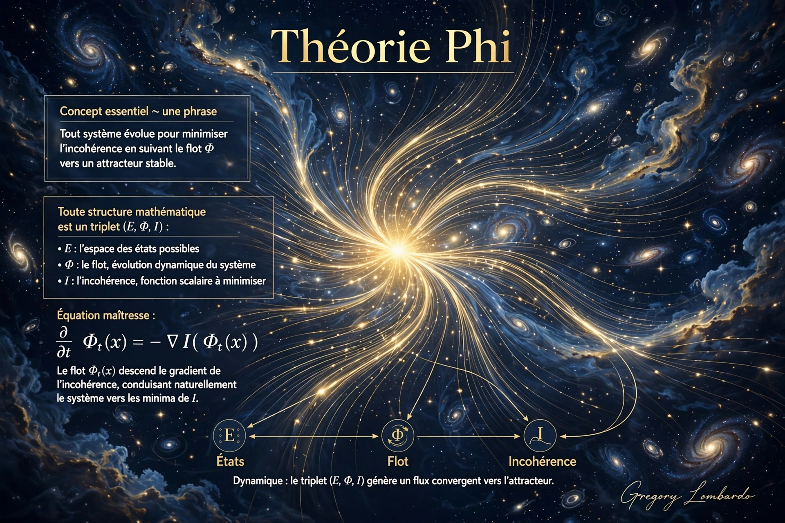

[](https://doi.org/10.5281/zenodo.24291589)

[](https://doi.org/10.5281/zenodo.24301051)

DOI Code GitHub v1.1 : 10.5281/zenodo.24301051
DOI Théorie Phi V1.1 : 10.5281/zenodo.24291589
DOI Théorie Phi V1.0 : 10.5281/zenodo.24287548

DOI Théorie Phi V1.1 : 10.5281/zenodo.24291589
DOI Théorie Phi V1.0 : 10.5281/zenodo.24287548
GitHub : https://github.com/gregory-lombardo/phi-theory
Zenodo V1.1 : https://zenodo.org/records/24291589

# phi-theory


Théorie Phi - Theory of Coherent Flows (E, Phi, I) - d/dt Phi = - grad I - Perelman Ricci flow as a special case

# Théorie Phi - Theory of Coherent Flows

**Auteur : Grégory Lombardo - CC BY 4.0 - Version 1.0**

Toute structure mathématique est un triplet `(E, Phi, I)` :
états, flot, incohérence.

Équation maîtresse :d/dt Phi_t(x) = - ∇ I(Phi_t(x))


Le flot de Ricci de Perelman est le cas particulier :
`E = métriques`, `Phi = flot de Ricci`, `I = énergie`.

## Dépôts officiels
- **Zenodo (horodatage, DOI) :** à ajouter après le dépôt Zenodo -> `10.5281/zenodo.XXXXXXX`
- **arXiv :** à ajouter après le dépôt arXiv
- **Manifeste :** voir `manifeste/`

## Dictionnaire d'unification
| Domaine | E | Phi | I |
|---|---|---|---|
| Géométrie (Perelman) | métriques | flot de Ricci | énergie |
| Algèbre | parenthésages | associativité | défaut d'associativité |
| Logique | propositions | déduction | nb contradictions |
| Probabilités | distributions | Markov | distance à la stationnaire |
| Comptage | N | n -> max(0, n-1) | I(n) = n |

## Langage universel
Message V3b en `•`, `->`, `o` : distinction, transformation, retour.
Testé à l'aveugle sur Lea, Karim, Ines, Noah, Mia.

## Lancer le code
```bash
pip install matplotlib numpy
python src/phi_system.py
python src/flows.py

